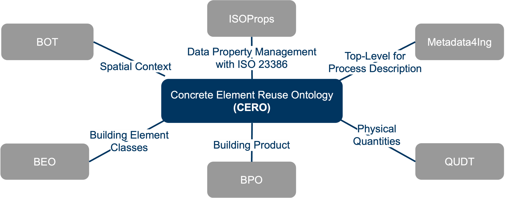

# Abstract

The Concrete Element Reuse Ontology (CERO) models metadata, structural elements, property groups, and properties relevant to cast-in-place structural concrete elements. It is designed to support the circular economy in construction by enabling the systematic digital tracking for the reuse of concrete elements. CERO complements its TBox class hierarchy with a flexible ABox-based property model, in which structured property groups and individual property instances are linked directly to physical assets. Furthermore, the ontology connects building components and material properties with scientific testing processes, measurement configurations, variables, and units.

The namespace for CERO terms is [http://www.w3id.org/cero#](http://www.w3id.org/cero#)

The suggested prefix for the CERO namespace is cero

The Turtle version of the CERO ontology is available at [https://rub-informatik-im-bauwesen.github.io/crc1683-ontologies/cero/ontology.ttl](https://rub-informatik-im-bauwesen.github.io/crc1683-ontologies/cero/ontology.ttl)

# Introduction

## Motivation & Usage

The Concrete Element Reuse Ontology (CERO) provides a semantic framework for representing cast-in-place concrete elements and their properties in support of structural reuse. It is developed to enable the systematic digital tracking of concrete elements and to facilitate circular construction practices. Since reuse workflows involve different information requirements at different stages, CERO captures both the structural elements themselves and the properties needed for their assessment, documentation, and reuse.

CERO combines a TBox class hierarchy with a flexible ABox-based property model, allowing concrete elements, property groups, and individual properties to be represented at different levels of abstraction and linked directly to physical assets. In addition, the ontology relates building components and material properties to testing, measurement configurations, variables, and units, thereby supporting interoperable and traceable reuse information.

The ontology is intended for use across the reuse workflow, including data acquisition, element inspection, supply-demand matching, and life cycle assessment. In this way, CERO provides a consistent basis for managing reuse-related information throughout the lifecycle of concrete elements.

## Design Overview
### Conceptual Architecture & Modeling Approach

The ontology architecture incorporates a structured property model in accordance with ISO 23386 (see [ISOProps](https://rub-informatik-im-bauwesen.github.io/ir-ontologies/isoprops/isoprops.html)). Property groups act as logical containers that aggregate related attributes to streamline data governance and ISO alignment. Meanwhile, individual properties are treated as concrete instances, allowing specific concrete elements to point directly to instantiated data values. Rather than declaring every domain property purely as a rigid TBox class, CERO leverages property instances tied to specific isoprops:GroupOfProperties.

### Ontology Network & Domain Mapping
The CERO acts as the central hub of an integrated ontology network designed for the reuse of concrete building elements. It harmonizes multiple standard and domain-specific vocabularies to manage spatial data, classifications, properties, and processes.
Below is the classification of the integrated domains and their respective functions within the network:

### Namespace declarations
Table of Namespaces used in the document 

|   |   |
|---|---|
|prefix|URL|
|cero|[https://w3id.org/cero](https://w3id.org/cero)|
|rdf|[http://www.w3.org/1999/02/22-rdf-syntax-ns](http://www.w3.org/1999/02/22-rdf-syntax-ns)|
|rdfs|[http://www.w3.org/2000/01/rdf-schema](http://www.w3.org/2000/01/rdf-schema)|
|xsd|[http://www.w3.org/2001/XMLSchema](http://www.w3.org/2001/XMLSchema)|
|sh|[http://www.w3.org/ns/shacl](http://www.w3.org/ns/shacl)|
|bot|[https://w3id.org/bot#](https://w3id.org/bot)|
|props|[https://w3id.org/props#](https://w3id.org/props)|
|isoprops|[https://w3id.org/isoprops](https://w3id.org/isoprops)|
|metadata4ing|[http://](http://w3id.org/nfdi4ing/metadata4ing/1.4.0/)[w3id.org/nfdi4ing/metadata4ing/1.4.0/](http://w3id.org/nfdi4ing/metadata4ing/1.4.0/)|

### Data Schema & Metadata

The CERO data schema bridges tabular property data with semantic process and property modeling using  [Metadata4Ing](https://nfdi4ing.pages.rwth-aachen.de/metadata4ing/metadata4ing/index.html). Parameters, values, and units are translated directly into semantic graph structures, mapping parameters to property instances, numerical values, and measurement units. Activities or testing procedures are modeled as processing steps. The processing step links to the specific target element, connects to domain-specific property definitions, and ties configuration details. Measured data is represented using variable assignment classes, in which quantitative aspects are structured to associate data points with their numerical values and units.

# Publications

- N. Grießmann, L. Guntermann, and N. Krautgartner, "Interoperable Enrichment and Querying of Circularity Information in IFC Models Using PSets, bSDD, and Ontologies", in Proc. of the 37. Forum Bauinformatik, Rostock, Germany, 2026. DOI: [10.18453/rosdok_id00005884](https://doi.org/10.18453/rosdok_id00005884).
- L. Guntermann, N. Krautgartner, H. Zielonka, P. Hagedorn, P. Mark, and M. König, “From inspection to digital passport: Tracing the provenance of testing data of concrete components for circular reuse”, in Proc. of the EC3 2026, Corfu, Greece, 2026. DOI: [10.35490/ec3.2026.290](https://doi.org/10.35490/ec3.2026.290).
- N. Krautgartner, F. Günther, P. Hagedorn, A. Hafner, and M. König, “A Semantic Digital Twin for the Sustainability Assessment of Reusable Structural Concrete Elements”, accepted for Proc. of the i3CE 2026, Incheon, South Korea, 2026. [Preprint available](https://www.researchgate.net/publication/417852310_A_Semantic_Digital_Twin_for_the_Sustainability_Assessment_of_Reusable_Structural_Concrete_Elements).
- P. Hagedorn et al., "Linking Design, Deconstruction and Characterization: A Digital Ecosystem for Sustainable Reuse of Cast-in-Place Concrete Elements", Beton- und Stahlbetonbau, 2026. DOI: [10.1002/best.70129](https://doi.org/10.1002/best.70129).
- H. Zielonka et al., "Modular Reuse of Existing Load-Bearing Structures: From Concept to Full-Scale Demonstration", Beton- und Stahlbetonbau, 2026. DOI: [10.1002/best.70148](https://doi.org/10.1002/best.70148).

<!-- ontolens:metadata -->
<!-- ontolens:visualization -->
<!-- ontolens:overview -->
<!-- ontolens:cross-reference -->
<!-- ontolens:prefixes -->
<!-- ontolens:used-ontologies -->
<!-- ontolens:quality-report -->
<!-- ontolens:downloads -->

 